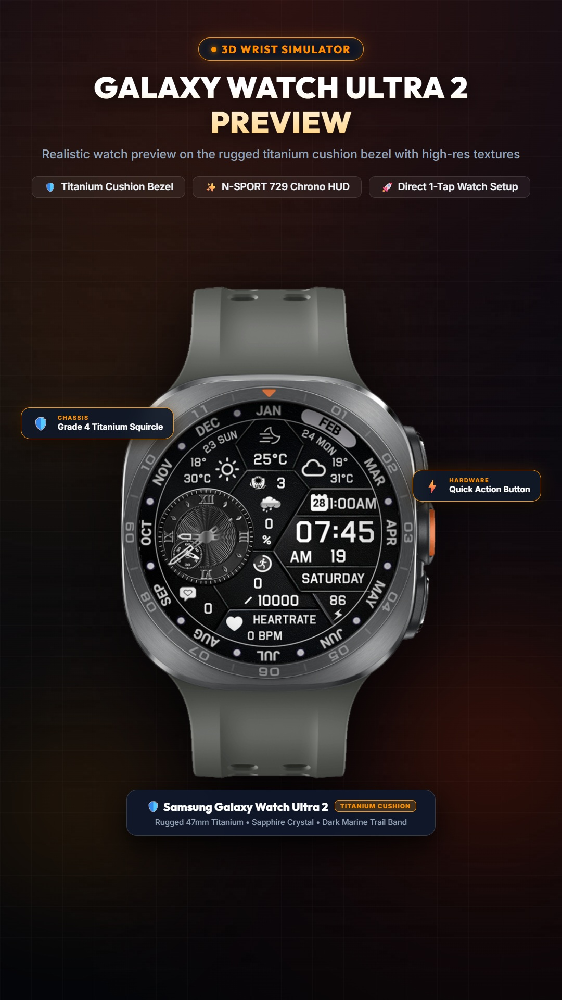
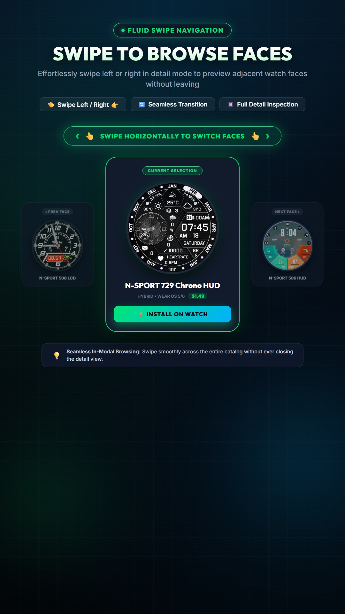
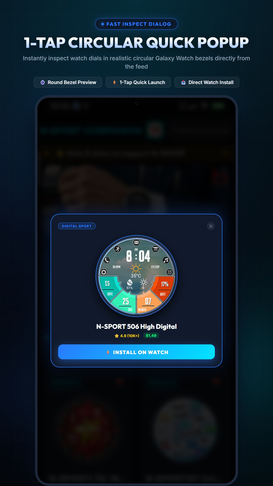
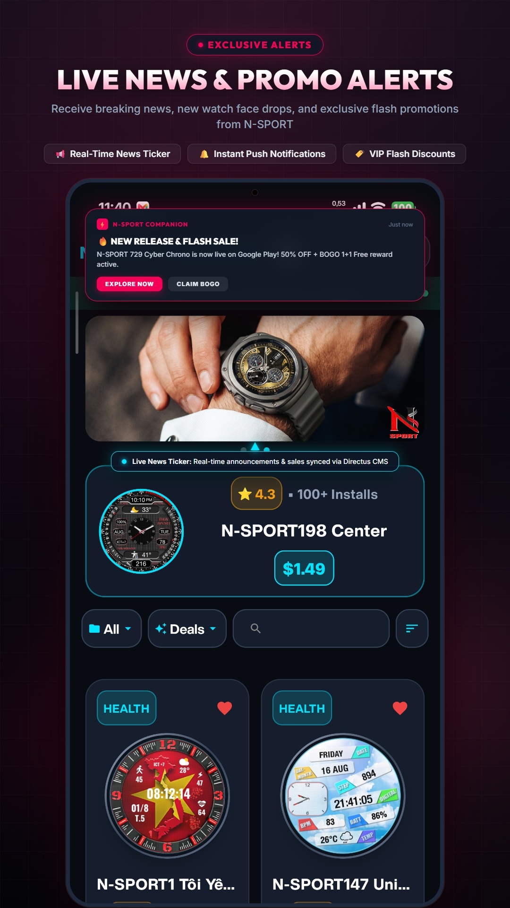

# N-SPORT WATCH FACE

**Premium watch faces for Samsung Galaxy Watch and Wear OS.**
Sophisticated design, diverse features and battery optimization.

[Website](https://nsportwatchface.com) · [Google Play](https://play.google.com/store/apps/dev?id=6578051238103683379) · support@nsportwatchface.com

---

## What we make

- **A catalog of 200+ watch faces** for Samsung Galaxy Watch and other Wear OS watches — hybrid, analog and digital designs under the N-SPORT brand, available on our [website](https://nsportwatchface.com), on Google Play and in the Companion app.
- **N-SPORT Companion** — the hub app for the catalog: browse faces on your phone, preview them on a realistic 3D wrist simulator (for example Galaxy Watch Ultra 2), swipe between faces and install on your watch in one tap.

## Featured watch faces

| Watch face | |
|---|---|
| N-SPORT764 Weather Colors Dial | [Google Play](https://play.google.com/store/apps/details?id=com.watchfacestudio.n_sport764) |
| N-SPORT787 WhiteMoon Watch Face | [Google Play](https://play.google.com/store/apps/details?id=com.watchfacestudio.n_sport787) |
| N-SPORT752 Hybrid Watch Face | [Google Play](https://play.google.com/store/apps/details?id=com.watchfacestudio.n_sport752) |
| N-SPORT786 Classic Watch Face | [Google Play](https://play.google.com/store/apps/details?id=com.watchfacestudio.n_sport786) |
| N-SPORT788 Luxury Hybrid Watch | [Google Play](https://play.google.com/store/apps/details?id=com.watchfacestudio.n_sport788) |
| N-SPORT753 Digital Watch Face | [Google Play](https://play.google.com/store/apps/details?id=com.watchfacestudio.n_sport753) |
| N-SPORT785 Gentleman Watch Face | [Google Play](https://play.google.com/store/apps/details?id=com.watchfacestudio.n_sport785) |
| N-SPORT676 Wear OS Watch Face | [Google Play](https://play.google.com/store/apps/details?id=com.watchfacestudio.n_sport676) |
| N-SPORT783 Hybrid Luxury Watch | [Google Play](https://play.google.com/store/apps/details?id=com.watchfacestudio.n_sport783) |

The full catalog: **[nsportwatchface.com](https://nsportwatchface.com)** · get the hub app: [N-SPORT Companion on Google Play](https://play.google.com/store/apps/details?id=com.nsportwatchface.companion)

## A look at the Companion app

<table>
  <tr>
    <td align="center"></td>
    <td align="center"></td>
    <td align="center"></td>
    <td align="center"></td>
  </tr>
  <tr>
    <td align="center">3D wrist simulator</td>
    <td align="center">Swipe to browse faces</td>
    <td align="center">Quick popup preview</td>
    <td align="center">Live news &amp; push</td>
  </tr>
</table>

## Work with us

Interested in a partnership or have a question? Write to **support@nsportwatchface.com**.
